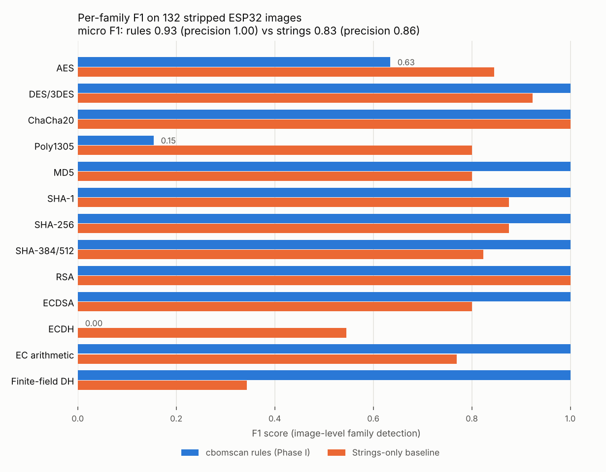

# cbomscan

**Find quantum-vulnerable cryptography inside compiled ESP32 firmware, and produce a
CycloneDX Cryptography Bill of Materials (CBOM) with a migration plan.**

III Semester Experiential Learning (EL) project, Department of CSE, RV College of Engineering,
Bengaluru. Status: **Phase I complete**, Phase II in progress.



---

## Contents

- [The problem](#the-problem)
- [What cbomscan does](#what-cbomscan-does)
- [Status: what is built, what is left](#status-what-is-built-what-is-left)
- [Quick start](#quick-start)
- [Phase I results](#phase-i-results)
- [Repository layout](#repository-layout)
- [Rebuilding the dataset](#rebuilding-the-dataset)
- [Documentation](#documentation)
- [Team and contributing](#team-and-contributing)

## The problem

ESP32 devices stay in the field for 10 to 15 years. Everything that establishes trust on them
(Secure Boot V2 signature checks, OTA update verification, mTLS device certificates, ECDH
session keys) rests on RSA or elliptic-curve cryptography, which Shor's algorithm breaks.
Resource estimates for breaking RSA-2048 fell from about 20 million physical qubits (2019) to under
one million (2025), and NIST's draft IR 8547 deprecates these algorithms after 2030 and disallows
them after 2035.

Migrating to post-quantum cryptography (ML-KEM, ML-DSA, LMS/XMSS) starts with an inventory:
you cannot replace RSA and ECC until you know where they are. Existing CBOM tools work on source
code or match strings, but deployed firmware is compiled, stripped and optimised. **cbomscan
works on the binary.**

More detail: [docs/threat_model.md](docs/threat_model.md) and
[docs/background_research.md](docs/background_research.md).

## What cbomscan does

```
firmware.bin ──► parse image ──► Tier 1 rules ──► classify risk ──► CycloneDX 1.6 CBOM
 (or flash       (segments,       (constants,       (quantum-       + Markdown/HTML report
  dump / ELF)     app descriptor,   OIDs, keys,       vulnerable?,   + evidence with addresses
                  Secure Boot V2    name strings,     NIST level,
                  signature block)  HW registers)     replacement)
                                   Tier 2 ML (Phase II)
```

For every algorithm it finds, the CBOM records the evidence (address, region, rule), a
confidence score, whether it is quantum-vulnerable, its NIST quantum security level, a migration
priority, the NIST replacement, and published ESP32 cost figures for that replacement.

It does **not** break or fix anything on the device. It is the diagnosis step of a migration.

## Status: what is built, what is left

| Phase | Item | Status |
|---|---|---|
| I | ESP32 image parser: app images, flash dumps (partition table), stripped ELF, app descriptor | Done |
| I | Secure Boot V2 signature block decoder (RSA-3072-PSS, ECDSA P-192/256/384) | Done |
| I | Tier 1 rules: spec-derived constants, literal-pool words, OIDs, embedded DER/PEM keys, algorithm-name strings, ESP32 accelerator registers | Done |
| I | Quantum-risk taxonomy, migration priority, replacement guidance | Done |
| I | CycloneDX 1.6 CBOM export, validated against the official schema on every run | Done |
| I | Labelled dataset: 132 images + 66 Secure Boot signed copies, truth from linker maps | Done |
| I | Evaluation harness with strings-only baseline and ablations; tests; CI | Done |
| II | Rebuild dataset with Espressif's `xtensa-esp32-elf-gcc` (windowed ABI) | To do |
| II | Held-out test set (wolfSSL, real ESP-IDF example apps) | To do |
| II | Xtensa disassembly + function boundary recovery for stripped code | To do |
| II | Tier 2 ML classifier for the rule gaps (ECDSA vs ECDH, run-time AES tables, Poly1305) | To do |
| II | Detection rules for post-quantum algorithms (ML-KEM, ML-DSA, LMS) so migrated firmware shows up correctly | To do |
| III | Migration feasibility model (flash, RAM, boot-time budget per chip) | To do |
| III | Other chips: ESP32-S2/S3/C3/C6/C5 accelerator addresses and chip-specific checks | To do |
| III | Optional demo: migrate one board with esp-pqc, rescan, show the CBOM change | To do |
| III | Write-up and paper | To do |

Each "To do" item is written up with acceptance criteria in [docs/ROADMAP.md](docs/ROADMAP.md).
To turn them into GitHub issues with labels, run once (needs the GitHub CLI, `gh auth login`):

```bash
./scripts/create_issues.sh
```

## Quick start

Python 3.10 or newer.

```bash
git clone https://github.com/angarkartanmay-ops/cbomscan.git
cd cbomscan
pip install -r requirements.txt

# scan one of the bundled dataset images
python -m cbomscan scan dataset/out/samples/m36rom__Os__full_stack__sbv2_rsa3072/firmware.bin -o out/

# look at the image structure
python -m cbomscan info dataset/out/samples/m36rom__Os__full_stack__sbv2_rsa3072/firmware.bin

# run the tests and reproduce every Phase I number
python -m pytest -q tests
python eval/evaluate.py
python eval/plot_results.py
```

Example output:

```
dataset/out/samples/m36rom__Os__full_stack__sbv2_rsa3072/firmware.bin: app-image, ESP32, 4 segments
  present: AES, CHACHA20, DES, ECC, ECDSA, FFDH, MD5, RSA, SHA1, SHA256, SHA512
  quantum-vulnerable: ECC, ECDSA, FFDH, RSA
  key: RSA public key (3072-bit, DER SPKI)
  key: EC P-256 public key (256-bit, DER SPKI)
  key: EC P-384 public key (384-bit, DER SPKI)
  key: RSA PSS public key (3072-bit, Secure Boot V2 signature block, block 0, CRC ok)
  wrote out/firmware.cbom.json (+ .report.md, .report.html, .evidence.json)
```

Sample outputs are in [`examples/`](examples/).

### Command reference

| Command | Purpose |
|---|---|
| `python -m cbomscan scan FILE -o DIR` | Scan an app image, flash dump or ELF; write CBOM, reports, evidence |
| `  --threshold 0.5` | Confidence needed to report a family as present |
| `  --groups constants,oid,keys,strings,names,hw,secure-boot` | Choose rule groups (ablation) |
| `  --no-validate` | Skip CycloneDX schema validation |
| `python -m cbomscan info FILE` | Print segments, app descriptor, signature blocks, partitions |
| `python -m cbomscan serve` | Start the Cryptolens dashboard (`--port`, `--no-browser`) |
| `python dataset/make_flash_dump.py app.bin dump.bin` | Wrap an app image into a 4 MB flash dump |

## Dashboard (Cryptolens)

Cryptolens is the web front end for cbomscan. It opens on an overview page that walks through
how the system works as you scroll (read the binary, match the maths, plan the migration, check
the result, project status), then leads into the console.

```bash
python -m cbomscan serve          # opens http://127.0.0.1:8765
```

**Console**

- Pick any bundled dataset image from the Firmware list, or drop your own ESP32 `.bin` on the page
  (or press Scan a file) to scan it.
- The image map shows the real layout of the firmware (DROM, DRAM, IRAM, IROM, signature block)
  with every finding at its address. Click a tick or a table row to select an algorithm; the code
  that reads its table lights up.
- The table lists all 13 algorithm families with confidence, quantum risk and fix priority.
- The side panel shows the evidence behind the selected algorithm, the NIST replacement and the
  published ESP32 cost figures.
- The Threshold slider changes the confidence needed to count an algorithm as present (the scanner
  default is 0.50). Lower it to see the findings the rules are unsure about, such as ECDH.

**Share it without installing anything.** `python scripts/build_demo_page.py` writes
`docs/dashboard-demo.html`, a single file with ten sample scans built in. It cannot scan new
files. Overview and console share one file, `cbomscan/dashboard/index.html`; the 3D scenes are
procedural Three.js (loaded from a CDN), with no image or model files.

## Phase I results

132 unsigned images, 13 algorithm families, image-level detection. Ground truth is the set of
families whose code is linked into each image.

| System | Precision | Recall | F1 |
|---|---|---|---|
| Strings-only baseline | 0.86 | 0.80 | 0.83 |
| Rules: constants only | 1.00 | 0.72 | 0.84 |
| Rules: all groups | **1.00** | **0.86** | **0.93** |

- No false positives in any rule configuration, including images with no cryptography.
- Every image containing quantum-vulnerable public-key crypto flagged (108/108), no false alarms (0/24).
- 66/66 Secure Boot V2 blocks decoded with the correct scheme, key size and curve.
- F1 is 0.93 at every optimisation level (-O0, -O1, -O2, -Os).

Where rules fail (the Phase II targets): **ECDH** (recall 0.00, shares all curve code with ECDSA),
**AES with run-time generated tables** (overall AES recall 0.46), **Poly1305** (recall 0.08, the
compiler folds a mask constant into shift instructions).

Full tables: [results/RESULTS.md](results/RESULTS.md). Analysis and threats to validity:
[docs/PHASE1_REPORT.md](docs/PHASE1_REPORT.md).

> **Read before quoting these numbers.** The rules were tuned on this dataset, so they are an
> upper bound; Phase II adds a held-out test set. The Phase I images were compiled with Ubuntu's
> Xtensa GCC (ESP8266 core, call0 ABI) and packed as ESP32 app images, because Espressif's
> toolchain could not be run in the build environment. Data-based rules are unaffected;
> instruction-level work must use images rebuilt with ESP-IDF's compiler.

## Repository layout

```
cbomscan/                 the scanner (Python package)
  image.py                ESP32 image / flash dump / ELF parser, Secure Boot V2 blocks
  signatures.py           spec-derived constant signatures, OIDs, name tokens, HW register windows
  keys.py                 DER/PEM public-key and certificate finder
  detect.py               rule engine, evidence combination
  taxonomy.py             algorithm families, quantum risk, replacements
  migration.py            migration priority, published esp-pqc cost figures
  cbom.py, validate.py    CycloneDX 1.6 export and schema validation
  report.py, cli.py       Markdown/HTML reports, command line
  api.py, server.py       scan result as JSON, local server for the dashboard
  dashboard/index.html    Cryptolens dashboard (single file)
  schemas/                official CycloneDX 1.6 JSON schemas
dataset/
  build_dataset.py        builds the labelled firmware dataset (toolchain is a parameter)
  profiles/               the 11 application profiles (C)
  configs/                mbedTLS configurations
  support/                linker script, startup, synthetic ESP32 crypto-accelerator driver, keys
  out/index.json          list of all samples with their truth
  out/samples/<sample>/   firmware.bin (scanner input) + truth.json (ground truth)
eval/
  evaluate.py             metrics, baseline, ablations -> results/
  baseline_strings.py     strings-only baseline
  plot_results.py         results chart
results/                  RESULTS.md, metrics.json, per_sample.json, chart
docs/                     report, threat model, roadmap, architecture, dataset, background research
examples/                 CBOM + reports for one signed full-stack image
tests/                    pytest suite
```

## Rebuilding the dataset

The committed dataset contains `firmware.bin` and `truth.json` for all 198 samples, which is
enough to scan and to reproduce the evaluation. To rebuild it (for example with a different
toolchain), see [docs/DATASET.md](docs/DATASET.md). Short version:

```bash
# Ubuntu toolchain used for Phase I
sudo apt install gcc-xtensa-lx106 binutils-xtensa-lx106 picolibc-xtensa-lx106-elf
./scripts/fetch_third_party.sh
python dataset/build_dataset.py

# Espressif ESP32 toolchain (Phase II), with ESP-IDF installed
. $IDF_PATH/export.sh
python dataset/build_dataset.py --toolchain-prefix xtensa-esp32-elf- --specs "" --out dataset/out_esp32
```

## Documentation

| Document | What is in it |
|---|---|
| [docs/PHASE1_REPORT.md](docs/PHASE1_REPORT.md) | Phase I write-up: what was built, results, failure analysis, threats to validity |
| [docs/ROADMAP.md](docs/ROADMAP.md) | Phase II and III plan, task breakdown, dependencies, acceptance criteria |
| [docs/ARCHITECTURE.md](docs/ARCHITECTURE.md) | How the scanner works internally, how to add a rule |
| [docs/DATASET.md](docs/DATASET.md) | Dataset design, truth format, rebuilding |
| [docs/threat_model.md](docs/threat_model.md) | Assets, adversary, why an inventory comes first |
| [docs/background_research.md](docs/background_research.md) | Literature base: quantum threat estimates, NIST standards, PQC on ESP32, CBOM state of the art |
| [results/RESULTS.md](results/RESULTS.md) | Every Phase I metric table |

## Team and contributing

Team of four (2 CSE, 2 AIML), RVCE. Maintainer: Tanmay Angarkar
([@angarkartanmay-ops](https://github.com/angarkartanmay-ops)). Teammates: add your names here.

Work is tracked as GitHub issues, grouped by phase label. Branch, test and PR workflow:
[CONTRIBUTING.md](CONTRIBUTING.md).

Third-party code (mbedTLS, miniz, jsmn, printf) is fetched at build time and not committed;
see their own licenses. The CycloneDX schemas in `cbomscan/schemas/` are from the CycloneDX
specification repository (Apache-2.0).
