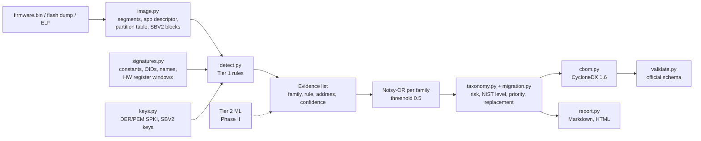

# Architecture

## 1. Parsing (`image.py`)

| Input | How it is recognised | What is extracted |
|---|---|---|
| ESP32 app image | first byte `0xE9` | header (chip id, entry), segments with load addresses, SHA-256 trailer, `esp_app_desc_t` at the start of DROM, Secure Boot V2 blocks at the next 4 KB boundary |
| Flash dump | partition table magic `0x50AA` at `0x8000` | partitions; the first app partition is parsed as above |
| ELF | `\x7fELF` | allocated sections; symbols are ignored so results match a stripped binary |

Each segment is tagged with an ESP32 memory region (IROM, DROM, IRAM, DRAM...) and a kind
(code or data).

## 2. Rule groups (`signatures.py`, `keys.py`, `detect.py`)

| Group | What it looks for | Typical confidence |
|---|---|---|
| `constants` | Byte patterns generated from the specs: AES S-boxes and T-tables, DES SP-boxes, SHA-2 K tables, curve parameters (big- and little-endian), DH primes. Word sets found anywhere 4-byte aligned, which catches constants the compiler put in literal pools (MD5, SHA-1, ChaCha20, SHA IVs). | 0.75 to 0.97 |
| `oid` | DER OID bytes (rsaEncryption, RSASSA-PSS, ecdsa-with-SHA*, id-ecPublicKey, X25519, dhKeyAgreement) | 0.4 to 0.45 |
| `keys` | Complete DER SubjectPublicKeyInfo structures (raw or inside PEM), with key size and curve | 0.85 |
| `strings` | PEM headers such as `-----BEGIN RSA PUBLIC KEY-----` | 0.35 |
| `names` | Exact algorithm-name strings from library metadata tables (`ECDSA`, `AES-128-GCM`...) | 0.4 |
| `hw` | Literal-pool words pointing into ESP32 AES / SHA / RSA accelerator register windows | 0.85 |
| `secure-boot` | Secure Boot V2 signature block after the image | 0.99 |

Weak groups (OIDs, names, PEM strings) are below the 0.5 threshold on their own, so a family is
only reported from metadata when two independent weak signals agree.

### Evidence combination

For each family, the best evidence per rule is kept and combined with a noisy-OR:
`confidence = 1 - Π(1 - c_rule)`, capped at 0.99. A family is present when confidence ≥ threshold.
If any ECDSA or ECDH finding is present, ECC is implied.

Two guard rules came from evaluation errors:
- every SHA-256/224 IV word is also half of a SHA-512/384 IV, so SHA-256 IV evidence is discounted
  to 0.25 when SHA-512 is present, and the SHA-512 IV rule uses only the halves not shared;
- curve-name strings are not used as ECC evidence because OID lookup tables carry them even when
  no curve arithmetic is linked.

## 3. Classification and migration (`taxonomy.py`, `migration.py`)

Each family has: CycloneDX primitive, quantum-vulnerable flag, NIST quantum security level
(0 = broken by a quantum computer or classically broken), classical status, risk, replacement.
Migration priority orders work: key agreement first (harvest now, decrypt later), then
signatures, then classically broken algorithms, then symmetric.

## 4. CBOM (`cbom.py`)

- `metadata.component`: the firmware (type `firmware`, SHA-256, app version)
- one `cryptographic-asset` / `algorithm` per present family, with `algorithmProperties`
  (primitive, executionEnvironment, curve, nistQuantumSecurityLevel), `evidence.identity`
  (technique `binary-analysis`) and `evidence.occurrences` (region and address)
- one `cryptographic-asset` / `related-crypto-material` per key, linked by `algorithmRef`
- extra facts as `properties` named `cbomscan:*` (risk, priority, replacement, cost notes)
- `dependencies`: firmware depends on every asset

Every scan validates the output against the official CycloneDX 1.6 schema and fails loudly if it
does not conform.

## 5. How to add a rule

1. Add a `Signature` in `cbomscan/signatures.py` (bytes pattern or word set, family, confidence,
   description). Prefer values derived from the algorithm specification over values copied from
   one library.
2. Run `python eval/evaluate.py` and check the per-family table and the "where evidence addresses
   fall" table: evidence should land in the same family's code.
3. Add a test in `tests/`.
4. Note in the PR whether the rule was designed while looking at the dataset (it usually was);
   the held-out set (Phase II) is the fair check.

## 6. Where Tier 2 plugs in

Tier 2 will add `Evidence` items with `group="ml"`, a function address as location, and a
calibrated confidence. Everything downstream (combination, CBOM, reports) already handles extra
evidence groups.
